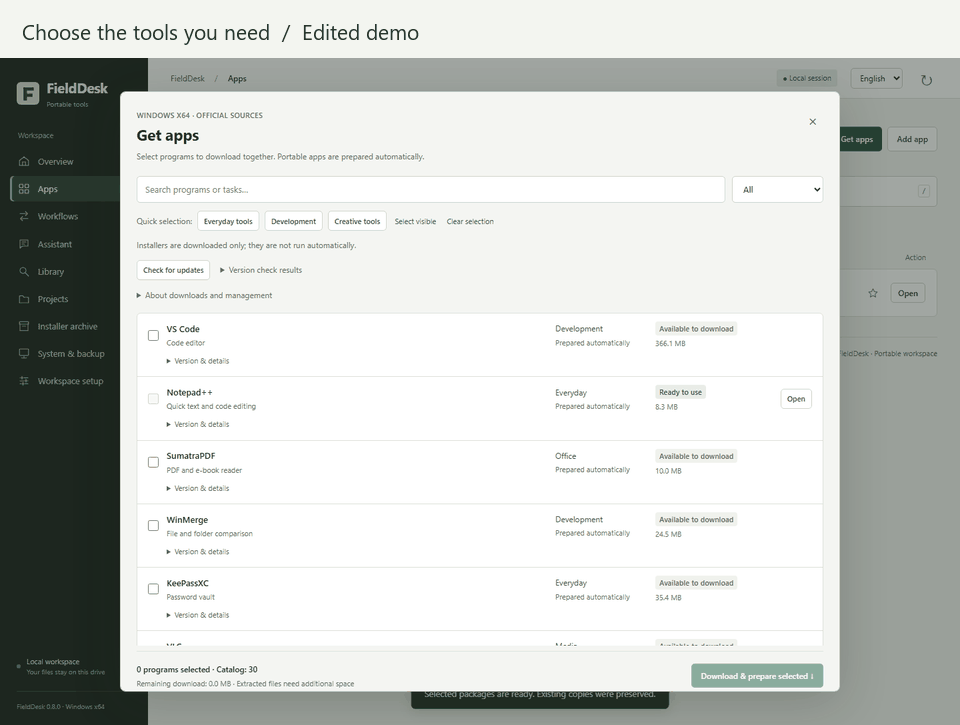

# FieldDesk

**Your Windows toolkit, on a drive.**

[Türkçe](README.tr.md) · [Roadmap](ROADMAP.md) · [Contributing](CONTRIBUTING.md)

**Preview release · Windows x64 · MIT source license**

Carry a workspace on a USB drive or external disk: choose your programs, work with documents and optionally chat with a local AI model from one interface. FieldDesk runs on your Windows computer. App downloads need the internet; document workflows and search run locally. Cloud chat is optional and uses your own API key.

[**Download Windows x64 · ~23 MB**](https://github.com/hasanyahsitr/fielddesk/releases/download/v0.8.0/FieldDesk-0.8.0-windows-x64.zip) · [Watch the demo](https://github.com/hasanyahsitr/fielddesk/releases/download/v0.8.0/FieldDesk-0.8.0-demo.mp4) · [First-run guide](docs/FIRST_RUN.md)



Real app capture with fictional documents. The GIF is an edited overview; the video shows the interaction sequence. AI and OCR require separately supplied components. [Demo details](docs/DEMO.md).

## Three ways to use it

- **A toolkit for another Windows PC:** keep the workspace on an external drive, download the tools you choose and launch supported portable apps from the menu. Host policies and third-party prerequisites still apply.
- **A document handover:** select two PDFs, review their order and page count, then merge them into a new output folder while keeping the originals.
- **Notes you can find offline:** keep project notes in the workspace, update the local index and search their text without sending it to a cloud service.

## Get started

From the [v0.8.0 preview release](https://github.com/hasanyahsitr/fielddesk/releases/tag/v0.8.0), download `FieldDesk-0.8.0-windows-x64.zip`, extract it and double-click `START.cmd`. The release includes Python, pypdf, Pillow and PDFium, so a separate Python installation is not required. Choose a workspace folder and run the setup check. Setup creates missing workspace folders; it does not download programs or AI models.

The interface defaults to **English**. Choose **Türkçe** in the top bar to switch without losing a typed message or visible conversation. The language preference is saved with the workspace and survives restarts. Documents, file paths, app inputs and model responses are not automatically translated.

To check the download in PowerShell, run `Get-FileHash .\FieldDesk-0.8.0-windows-x64.zip -Algorithm SHA256` and compare the result with its `.sha256` companion file.

## What it does

- **Apps:** search, favorites, native app launchers and custom portable executables.
- **App catalog:** choose from 30 pinned Windows x64 packages, download from official sources and verify size and SHA-256. 25 can be prepared automatically; 5 download an installer only. Installers are never run automatically.
- **Assistant:** general conversation with a local GGUF model, including recent conversation context. Documents are optional: turn on Use my documents for a separate retrieval mode. The assistant follows the language of your message, independently of the interface language.
- **Optional cloud chat:** NVIDIA, OpenAI, Google Gemini, Anthropic, Groq, OpenRouter, DeepSeek and compatible local/custom endpoints. Actual access depends on your provider, model and quota. Review document excerpts before sending them to a cloud provider.
- **Library:** offline search across text, code, HTML, PDFs, DOCX, XLSX and PPTX. Legacy Office formats, encrypted documents and embedded objects are not supported; spreadsheet formulas are not recalculated.
- **Workflows:** preview and merge PDFs, optimize images, extract scanned text with OCR and open a project environment. Outputs go to new task folders; source files are preserved. Project scripts and dependency installers are not run automatically.
- **System:** check capacity and backup records. A second physical backup drive is configured separately.

## Local AI

The release does not include large model files or a model runtime. Supply a compatible Windows x64 `llama-server.exe` and a supported GGUF file. The currently supported file layouts are listed in `app/engine.py`; the smaller Gemma E2B option is the starting choice for this workspace. Loading from an HDD may take minutes. Local inference uses CPU in this version. Model outputs still require review, especially for important decisions.

General chat works without indexed documents. Recent context is bounded and kept only in the open page; reloading clears it. Switching providers clears conversation context, and switching between general and document chat starts a separate context. This is a text assistant, not a computer-control agent: it cannot browse the web, modify files or execute commands through chat.

OCR requires a separately supplied Tesseract engine and language data; they are not bundled.

## Downloads and updates

Interrupted downloads retain their partial file and resume when the server supports a valid HTTPS Range response. Completed archives must pass size and hash checks before extraction. Version checks use official APIs for 24 packages and publisher pages for 6; they compare with the pinned catalog, not unknown existing installations. New versions are not automatically downloaded or installed.

Managed packages can be removed and restored. Removal retains files for undo and does not free disk space. Profile data is preserved. Existing unrelated folders are not overwritten. First launch may require a license, network access or additional runtime; third-party licenses apply.

## Run from source

```powershell
python -m pip install -r requirements.txt
python -X utf8 app/server.py --root "D:\FieldDesk"
```

FieldDesk serves its UI on loopback only. Mutating requests require session, host and origin checks. API credentials stay in the current session by default; optional Windows DPAPI storage is tied to the Windows user and computer. Do not expose the local server to the public internet or commit personal data.

Existing ATÖLYE workspaces are supported without moving files. Internal `ATOLYE_ROOT`, `X-Atolye-*`, `.atolye-*` and numbered folder names remain compatible with earlier releases. The display name and release archives are now FieldDesk.

## Development and releases

```powershell
python -X utf8 -m unittest discover -s tests -v
node tests/test_i18n.js
python -X utf8 scripts/build_release.py
python -X utf8 scripts/build_windows.py --python-runtime PATH_TO_EMBEDDED_PYTHON --packages PATH_TO_MODULES
```

Release scripts use an explicit file allowlist. Personal files, API keys, third-party programs, installers and model weights are not included. Never upload an entire real workspace drive to GitHub. Windows runtime builds include dependency licenses. See [LICENSE](LICENSE) for the FieldDesk code license.

This is an early Windows x64 release. The app catalog is intentionally pinned, local model performance depends on hardware, and the package catalog is not a claim that every third-party app has been exhaustively tested.

## Feedback and contribution

Bug reports and feature requests in English or Turkish are welcome. Include your FieldDesk version, Windows version and reproduction steps using test data. Remove API keys, session tokens and personal document excerpts from screenshots and logs. Use [CONTRIBUTING.md](CONTRIBUTING.md) for development and [SECURITY.md](SECURITY.md) for security-sensitive reports.

Trying FieldDesk for the first time? Follow the [five-minute first-run checklist](docs/FIRST_RUN.md), then tell us where you got stuck and whether you would use it again. To contribute code or documentation, start with [good first issues](https://github.com/hasanyahsitr/fielddesk/issues?q=is%3Aissue%20is%3Aopen%20label%3A%22good%20first%20issue%22) or [help wanted](https://github.com/hasanyahsitr/fielddesk/issues?q=is%3Aissue%20is%3Aopen%20label%3A%22help%20wanted%22).

See the [changelog](CHANGELOG.md), [preview release notes](docs/RELEASE-v0.8.0.md) and [roadmap](ROADMAP.md). The Windows CI workflow checks backend behavior, JavaScript syntax, localization and source release contents; the initial [GitHub-hosted Windows run](https://github.com/hasanyahsitr/fielddesk/actions/runs/38172259405) passed. Real OCR/model checks are performed separately with a supplied local kit.

## License and attribution

FieldDesk source uses the [MIT license](LICENSE). Bundled runtime dependencies and separately downloaded tools keep their own licenses; see [third-party notices](THIRD_PARTY_NOTICES.md). FieldDesk is a working project name; name availability and trademark registration have not been established.
