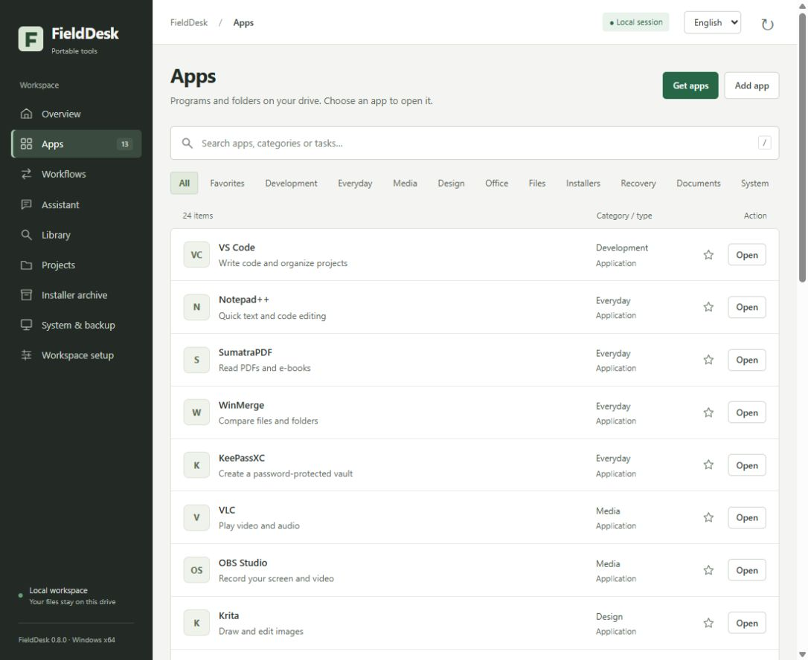

# FieldDesk

[English](README.md) · [Yol haritası](ROADMAP.md) · [Katkı rehberi](CONTRIBUTING.md)

**Önizleme sürümü · Windows x64 · Kaynak kod MIT lisanslı**

**Taşınabilir çalışma çantan için tek bir kontrol merkezi. · v0.8.0**

Uygulamalar, projeler, yerel veya API üzerinden yapay zekâ, belge araması, PDF birleştirme, web görseli hazırlama, OCR ve Office araması aynı arayüzde. Windows x64 üzerinde yerel çalışır. Temel işlevler için bulut hesabı gerekmez. Dosya iş akışları çevrimdışıdır; yerel sohbet için ayrıca bir model ve llama.cpp gerekir. İsteğe bağlı API sohbetinde kullanıcı kendi sağlayıcı hesabını ve anahtarını kullanır.

## FieldDesk · v0.8

Varsayılan arayüz dili İngilizcedir; üst çubuktan Türkçe seçilebilir. Dil tercihi çalışma alanına kaydedilir ve yeniden açılışta korunur. Dil değişikliği sohbeti veya yazılmış mesajı silmez; dosya yolları ve model yanıtları çevrilmez.

Yerel modelde normal sohbet için belge gerekmez. Asistan kullanıcı mesajının dilini izler ve aynı sağlayıcıyla son dört mesajı (mesaj başına en fazla 750 karakter) bağlam olarak kullanır. Belgelere dayalı yanıt için “Belgelerime dayan” ayrıca açılır. Sayfa yenilendiğinde sohbet geçmişi silinir; belge modu veya sağlayıcı değiştirildiğinde modelin bağlamı sıfırlanır. Yanıtlar doğruluk güvencesi taşımaz. İlk yerel yükleme HDD üzerinde birkaç dakika sürebilir.

Proje adı FieldDesk oldu; mevcut çantalarla uyumluluk için D:\ATOLYE gibi yollar ve dahili ATOLYE yapılandırma adları korunur.

## Arayüz · v0.7

Açık çalışma alanı, kompakt uygulama listesi ve sade yan menü. Program kataloğunda seçim, durum ve boyut bir satırda; sürüm, kaynak ve kaldırma işlemleri ayrıntılarda. Arayüz sistem yazı tiplerini ve yerel SVG ikonlarını kullanır; harici font veya görsel servisi gerektirmez.

## Paket yönetimi · v0.6

Program satırlarında indirilebilir, sırada, indiriliyor, doğrulanıyor, hazırlanıyor, hazır, kurulum dosyası hazır, yarım kalmış ve hata durumları açıkça gösterilir. Hazır program doğrudan açılabilir; CLI ve kurulum paketlerinde klasör açılır. Hata mesajı ve yeniden deneme aynı satırdadır.

**Devam et:** kesilen/iptal edilen indirmelerde yazılmış kısım `.part` dosyasında korunur. Uygulama yeniden açılsa veya çanta taşınsa da programı tekrar seçebilir ya da Devam et düğmesine basabilirsin. Sunucu HTTPS Range isteğine geçerli 206/Content-Range yanıtı verirse kalan kısım alınır. 200 yanıtı verirse dosya baştan indirilir; yanlış Range yanıtında eski kısım korunur. Tam dosyanın boyutu ve SHA-256 değeri doğrulanmadan arşiv açılmaz. Hash uyuşmazlığında bozuk yarım dosya silinir. Kendiliğinden devam etme veya tekrar deneme yoktur. Bekleyen ağ okuması iptali 30 saniyeye kadar geciktirebilir. Windows yol sınırını aşacak arşivler açılmadan reddedilir; D:\ATOLYE gibi kısa bir çanta yolu kullan. Doğrulanmış arşiv korunur.

**Güncellemeleri kontrol et:** 24 pakette yayıncının resmî API bilgisini, 6 pakette yayıncı sayfasını kullanır. GitHub latest kararlı sürümü, Node.js LTS, VS Code stable ve desteklenen kararlı .NET SDK sürümleri karşılaştırılır. Karşılaştırma **katalogda sabitlenmiş sürüme** yapılır; mevcut elle eklenmiş kopyanın sürümü ölçülmez. Ağ/API kotası hatası güncel sayılmaz. Sonuç ve kontrol zamanı yerel saklanır; 10 dakika boyunca tekrar aynı sorgu yapılmaz. Açılışta dış istek yoktur. Kontrol düğmesi programı güncellemez: yeni dosyanın URL, boyut ve SHA-256 bilgileri katalogda ayrıca gözden geçirilip sabitlenmelidir. Yayıncı sayfası gösterilir; mevcut kopya değiştirilmez.

**Kaldır · geri alınabilir:** yalnızca Paket merkezinin yönettiği paketlerde vardır. Menüyü kaldırır; kendi uygulama klasörünü veya kendi kurulum arşivini `00_BASLANGIC/KaldirilanPaketler` altında saklar. Profil verileri korunur. Önceden mevcut, paylaşılan bir kurulum arşivi kullanılmışsa asıl dosya taşınmaz. Geri al düğmesi aynı sürümü menüye döndürür. Yeni kopyanın veya dolu klasörün üzerine yazılmaz. FieldDesk üzerinden açılıp hâlâ çalışan program kapatılmadan kaldırılmaz; Windows dosya kilidi hatasında işlem geri alınır. **Kalıcı silme yoktur; kaldırma disk alanını boşaltmaz.** ZIP'e kaldırılan dosyalar veya bu işlem kayıtları eklenmez.

## Program seç, tek tıkla indir · v0.5

**Uygulamalar → Program indir → kutucukları işaretle → Seçilenleri indir ve hazırla.** Ek onay penceresi yoktur. Kategori ve arama filtreleri, günlük / kod / içerik seçim grupları, toplam indirme boyutu, ilerleme ve iptal düğmesi vardır. Çantada zaten bulunan programlar korunur ve yeniden indirilmez; mevcut kopyanın sürümünün katalog sürümü olduğu iddia edilmez.

Katalog 30 Windows x64 paketi içerir:

| Kategori | Programlar |
|---|---|
| Günlük / ofis | Notepad++, SumatraPDF, WinMerge, KeePassXC, LocalSend, PeaZip, 7-Zip, LibreOffice |
| Medya / tasarım | VLC, OBS Studio, Krita, Blender, ShareX, HandBrake, ScreenToGif, Audacity |
| Yazılım / araçlar | VS Code, VSCodium, DB Browser for SQLite, Node.js, uv, ripgrep, jq, SQLite, PowerShell, .NET SDK, llama.cpp, Fastfetch, Python, Git |

**25 paket otomatik hazırlanır:** resmî kaynaktan indirme → sabit SHA-256 özeti ve boyut kontrolü → güvenli ZIP açma veya tek dosyayı hazırlama → menü kaydı. CLI araçlarında menü programın klasörünü açar. VS Code/VSCodium için taşınabilir `data` klasörü oluşturulur. **5 pakette yalnızca kurulum dosyası indirilir:** 7-Zip, LibreOffice, Python, Git ve Audacity. Bunların kurulumu ve lisans kabulü ayrıca kullanıcıya aittir; otomatik çalıştırılmazlar. Hiçbir indirme işlemi programı kendiliğinden başlatmaz.

Paket sürümleri 11 Ekim 2026 tarihli katalogda sabitlenmiştir; kendiliğinden en yeni sürüme geçilmez. Bazı özetler yayıncının release bilgisinden, bazıları resmî HTTPS indirmesinin kayıtlı SHA-256 değerinden gelir; kartlarda bu fark belirtilir. SHA-256 eşleşmesi özgünlük veya zararlı yazılım bulunmadığı güvencesi değildir. Uygulamaların ilk açılışta ek çalışma zamanı, ağ, lisans veya hesap isteyebileceği kart notlarında belirtilir. Windows x64 dışındaki platformlar bu katalogda desteklenmez.

Arşivler `02_KURULUMLAR/PaketMerkezi`, hazırlanan uygulamalar `01_TASINABILIR/PaketMerkezi`, göreli yol kayıtları `00_BASLANGIC/Kayitlar/paket-merkezi.json` altında kalır. Doğrulanmış arşiv yeniden kullanılabilir. Bozuk/eksik indirme hazırlanmaz; hatalı bir paket kuyruğun kalanını durdurmaz. İptal bekleyen ağ okumasına göre en fazla 30 saniye sürebilir; tamamlanan paketler korunur. Otomatik tekrar veya toplu güncelleme yoktur; v0.6 ile yönetilen paketlerde geri alınabilir kaldırma eklendi. İndirme boyutuna ek olarak arşiv açma alanı gerekir. GitHub dağıtım ZIP'leri bu 30 programın dosyalarını içermez; yalnızca katalog ve FieldDesk kodu taşınır.

## Kendi API anahtarınla asistan · v0.4

Asistan → Sağlayıcı → API bağlantısını düzenle. Anahtarını **uygulamadaki parola alanına** gir; sohbete veya GitHub'a yapıştırma. Bağlantıyı kaydet, “Modelleri getir” ile listeden bir **metin sohbeti modeli** seç veya tam kimliğini yaz. “Bağlantıyı dene” yalnızca kısa bir OK isteği gönderir; ücret/kota tüketebilir. Kaydetmek tek başına dış istek yapmaz. Model seçimi hesabındaki erişime bağlıdır; liste ilk sayfayla sınırlı olabilir ve sohbet dışındaki modelleri de içerebilir.

| Bağlantı | Desteklenen protokol |
|---|---|
| [NVIDIA](https://docs.api.nvidia.com/nim/reference/llm-apis) | Chat Completions |
| [OpenAI](https://developers.openai.com/api/reference/resources/chat/subresources/completions/methods/create) | Chat Completions; `max_completion_tokens` |
| [Google Gemini](https://ai.google.dev/gemini-api/docs/openai) | Gemini'nin OpenAI uyumluluk uç noktası |
| [Anthropic Claude](https://platform.claude.com/docs/en/api/messages/create) | Native Messages; system ve metin blokları |
| [Groq](https://console.groq.com/docs/openai), [OpenRouter](https://openrouter.ai/docs/api/api-reference/chat/create-a-chat-completion), [DeepSeek](https://api-docs.deepseek.com/) | Chat Completions |
| Özel servis | Chat Completions veya Anthropic Messages uyumlu temel adres |

Özel servis örneği: `https://sunucu.example/v1`. Tam `/chat/completions` adresini girme. HTTPS gerekir; HTTP yalnızca `localhost`, `127.0.0.1`, `::1` üzerinde kabul edilir. Bu yolla Ollama/LM Studio gibi yerel uyumlu sunucular kullanılabilir; ayrıca kurulup başlatılmalıdır, anahtarları zorunlu değildir. Özel LAN adresleri bu sürümde desteklenmez. URL'ye parola, sorgu veya anahtar eklenmez. Endpoint değiştiğinde önceki anahtar yeni adrese aktarılmaz; yeniden girilmesi gerekir. HTTP yönlendirmeleri ve ortam proxy'leri kullanılmaz; DNS hedefi kontrol edilip aynı IP'ye bağlanılır ve HTTPS sertifikası doğrulanır.

Anahtar varsayılan olarak yalnızca sunucu belleğindedir; uygulama kapanınca unutulur. İsteğe bağlı **Windows DPAPI** kaydı `00_BASLANGIC/Kayitlar/providers.dpapi` içinde şifrelenir ve aynı bilgisayardaki Windows hesabına bağlıdır. Başka bilgisayarda yeniden anahtar girilir. “Anahtarı unut” kayıtlı bağlantıyı siler. Anahtar sunucu durum yanıtına, localStorage'a, sohbet geçmişine, normal uygulama loglarına ve dağıtım ZIP'lerine eklenmez. Bu koruma aynı Windows hesabında çalışan zararlı yazılıma karşı izolasyon sağlamaz; çantadaki diğer dosyaları şifrelemez.

Yerel mod varsayılandır; bu modda API çağrısı yapılmaz. API modunda mesaj ve aynı sağlayıcıyla yakın geçmiş (en fazla 4 mesaj, mesaj başına 750 karakter) seçilen servise gönderilir. Sağlayıcı veya bağlantı ayarı değişince sohbet temizlenir. Belge modu önce **soru, hedef ve en fazla 4 × 800 karakter alıntı** gösterir. Yalnızca “Bu soru ve alıntıları gönder” düğmesiyle bunlar gönderilir; önceki sohbet ve dosya yolu/adı otomatik bağlama eklenmez. Alıntının kendi içindeki hassas bilgiler ayrıca kontrol edilmelidir. Onay 5 dakika geçerli, tek kullanımlıdır; onaylanan alıntı değişmez. Boş arama sonucu gönderilmez.

API istekleri metinle sınırlıdır; ajan araçları, görsel/ses/video üretimi, OAuth tabanlı servisler, Azure/Bedrock/Vertex kimlik doğrulaması ve sağlayıcıya özel tüm parametreler desteklenmez. “Tüm yapay zekâlar” veya tüm modellerin uyumu garantisi verilmez. Çıktı sınırı 2048 tokendir; bazı modellerde düşünme tokenları da bu sınıra dahildir. Kesilme gösterilir; boş metin yanıtı uyumluluk hatası sayılır. Zaman aşımı 60 saniye, yanıt sınırı 2 MB'dır. Token kullanımı sağlayıcının döndürdüğü ölçümdür, ücret veya kalan kota hesabı değildir. Hata olduğunda başka sağlayıcıya veya modele otomatik geçiş/tekrar yapılmaz; OpenRouter için sağlayıcı fallback'i de kapalıdır. Servisin kendi model yönlendirmesi ve veri politikası ayrıca geçerlidir. Durdurma, yerel sonucu iptal eder; gönderilmiş API isteğinin sağlayıcıdaki işlem/ücretini geri almaz.

FieldDesk API kredisi veya ücretsiz erişim sağlamaz. NVIDIA dahil deneme/ücretsiz erişimler sağlayıcının güncel hesap, kota ve koşullarına tabidir; sınırsız ücretsiz kullanım sözü verilmez. [NVIDIA API deneme koşulları](https://assets.ngc.nvidia.com/products/api-catalog/legal/NVIDIA%20API%20Trial%20Terms%20of%20Service.pdf).

Bağlantı sözleşmeleri, yerel HTTP test sunucusu, anahtar gizliliği, DPAPI, kota hatası, iptal ve belge onayı sentetik verilerle test edilir. Gerçek hesap anahtarı olmadan yetkili bulut sohbetinin başarıyla çalıştığı iddia edilmez. Her kullanıcının anahtarı/modeli uygulamadaki bağlantı testiyle ayrıca doğrulanmalıdır.



*Örnek dolu çanta görünümü. Kaynak kod paketi bu araçları ve modelleri içermez.*

## Başlat

**Windows çalıştırma paketi:** `FieldDesk-0.8.0-windows-x64.zip` dosyasını bir klasöre çıkarıp `START.cmd` dosyasını aç. Python, pypdf, Pillow ve PDFium bu pakettedir; Python kurman gerekmez. İlk açılışta çanta klasörünü seçip kontrol et, ardından “Bu çalışma alanını hazırla” düğmesini kullan. Bu hazırlıkta uygulama veya model indirilmez; programları daha sonra Paket merkezinden seçebilirsin.

**Kaynak kod:** Python 3.12 veya 3.13 ile paketleri kur, ardından başlat:

```powershell
python -m pip install -r requirements.txt
python -X utf8 app/server.py --root "E:\ATOLYE"
```

`START.cmd` önce yanındaki runtime'ı, sonra `ATOLYE_ROOT` ortam değişkenindeki PythonMini'yi, sonra sistem Python'unu kullanır. Çanta seçimi `.atolye-local.json` içinde yerel saklanır; aynı sürücüdeyse taşınmaya uygun göreli yol kullanılır. `--root` ve `ATOLYE_ROOT` açık seçimleri bu ayarı geçersiz kılar. İlk seçim yoksa çanta işaret dosyası aranır; bulunamazsa `.atolye-data` içinde boş çalışma alanı oluşur. Araçları olmayan bir kurulum dolu çanta gibi gösterilmez.

## Neler yapar?

- Genel bakış, uygulama arama, kategori filtreleri ve yerel favoriler.
- 30 programlık Paket merkezi: kutucuklarla seç, tek tıkla indir, doğrula, hazırla ve menüye ekle.
- İlk açılışta klasör, bağımlılık ve temel araç kontrolü; mevcut dosyalara dokunmadan klasör hazırlama.
- Çanta içindeki taşınabilir `.exe` dosyalarını arayüzden kaydetme ve menüden kaldırma. Kaldırmak program dosyasını silmez.
- PDF birleştirme, web görseli hazırlama, OCR ve proje ortamı açma: önce önizle, sonra çalıştır.
- Taşınabilir programları kendi pencerelerinde açma.
- Gemma E2B, Gemma E4B veya Qwen3 4B ile arayüz içinde metin sohbeti.
- Model yükleme/yanıt durumunu izleme, çalışan modeli durdurma.
- Metin, kod, HTML, PDF, DOCX, XLSX ve PPTX belgelerde SQLite FTS5 araması; yerel alıntılara dayanan soru cevap.
- Projeleri klasör veya VS Code çalışma alanı olarak açma.
- Paket arşivindeki gerçek dosya varlığını ve kayıtlı doğrulama bilgisini gösterme.
- Bellek, disk ve yedek durumunu görme; varsa çantanın yedekleme başlatıcısını açma.

Program pencereleri arayüzün içine gömülmez. Bu sürüm telefon kontrolü, bilgisayar kullanım ajanı, otomatik işletim sistemi kurulumu veya evrensel paket yöneticisi değildir. Görsel/ses modeli projektörleri kullanılmaz. Sohbet geçmişi sayfada bellekte tutulur; diske sohbet arşivi yazılmaz. Yenilemeden sonra sunucunun son yanıtı gösterilebilir; “Sohbeti temizle” bunu da siler.

## Dört iş akışı

| İş akışı | Önizleme | İşlem |
|---|---|---|
| PDF birleştir | Seçilen sıra, dosya başına sayfa ve toplam sayfa | Yeni bir PDF oluşturur; çıktının sayfa sayısını doğrular. |
| Web görselleri | Orijinal ve hedef piksel ölçüleri, format, kalite | WebP/JPEG/PNG üretir; küçük görselleri büyütmez, EXIF'i aktarmaz. |
| Metin oku · OCR | Türkçe/İngilizce, sayfa sayısı ve döndürme | Tesseract ile çevrimdışı TXT ve metin katmanı olan PDF üretir; iptal edilebilir. |
| Proje ortamı | Klasör, araç yolları, node_modules ve npm komut adları | Seçilen klasörde terminali, istenirse VS Code'u açar. Bağımlılık yüklemez ve proje komutlarını çalıştırmaz. |

Girdiler çantadan seçilebilir veya bilgisayardan yüklenebilir. Yüklemeler yalnızca yerel sunucuya gider ve `12_ISLER/Girdiler` içinde kopya olarak kalır. Kaynak dosyalar değiştirilmez. Her işlem yeni bir `12_ISLER/Ciktilar/TARIH-ID` klasörü ve `islem-raporu.json` oluşturur; çıktılarda SHA-256 kayıtları vardır. Önizlemeden sonra değişen girdiler reddedilir. Önizleme 15 dakika geçerlidir, bir kez çalıştırılabilir ve yeniden başlatmada geçersiz olur.

Sınırlar: dosya başına 50 MB, toplam 150 MB, 30 dosya; PDF'de toplam 1000 sayfa; görselde 40 megapiksel. Şifreli PDF ve hareketli görsel desteklenmez. OCR tek işlemde toplam 50 sayfa ve sayfa başına 40 megapiksel ile sınırlıdır; PDF 300 DPI render edilir. OCR sayfası için 120 saniye zaman aşımı vardır. PDF yer işaretleri ve etkileşimli formlar korunmayabilir. JPEG'de şeffaf alanlar beyaz olur. PNG için kalite alanı kullanılmaz. Bir işlem hata verirse eksik çıktılar ayrı klasörde hata raporuyla kalabilir; başarılı tamamlanmış sayılmaz.

Özel uygulama kayıtları göreli yollarla `00_BASLANGIC/Kayitlar/ozel-uygulamalar.json` içinde tutulur. Uygulamaya serbest komut/parametre girilmez. APPDATA yönlendirmesi uygulamanın gerçekten taşınabilir olduğunu garanti etmez; yayıncının taşınabilir sürümünü kullan.

## OCR ve Office araması

HDD'deki hazırlanmış çantada OCR motoru ve Türkçe/İngilizce dil dosyaları vardır. **Genel Windows ZIP'i Tesseract veya dil modellerini içermez.** OCR için [Tesseract projesinin önerdiği Windows dağıtımını](https://tesseract-ocr.github.io/tessdoc/Downloads.html) ve [tessdata_best dil dosyalarını](https://github.com/tesseract-ocr/tessdata_best) lisanslarına uygun edin. Çanta içindeki düzen:

```text
01_TASINABILIR/Tesseract/tesseract.exe
01_TASINABILIR/Tesseract/…yayıncı DLL dosyaları…
01_TASINABILIR/Tesseract/tessdata/tur.traineddata
01_TASINABILIR/Tesseract/tessdata/eng.traineddata
01_TASINABILIR/Tesseract/tessdata/configs/{txt,pdf}
```

Çanta hazırlığı OCR motorunu, dil dosyalarını ve PDFium paketini kontrol eder. Eksik motor hazırmış gibi gösterilmez. Hiçbir belge bulut servisine gönderilmez. OCR döndürme seçeneği saat yönündedir; otomatik yön/masa eğimi düzeltmesi yoktur. El yazısı, karmaşık tablolar ve tek tek yazılmış harflerde doğruluk güvencesi verilmez. Hazırlanan çantada ayrıntılı tessdata_best modelleri kullanılır; hız için otomatik model değiştirilmez. Adları, tutarları ve diğer kritik bilgileri kaynağıyla karşılaştır.

`okunan-metin.txt` ve `aranabilir.pdf` ayrı çıktı klasöründe üretilir. Metin önizlemesi ilk 5000 karakterdir. Aranabilir PDF sayfaları görüntüden yeniden oluşturulur; kaynak PDF'nin bağlantı, form, imza veya yapısı korunmaz. Kaynak dosya değiştirilmez. OCR iptali motoru durdurur; başarısız/iptal edilmiş iş klasörleri arama dizinine alınmaz. Başarılı sonuç ekranındaki “Sonuçları Bilgi merkezine ekle” dizini günceller.

Bilgi merkezi `04_PROJELER`, tasarım/rehber/şablon klasörleri ve yalnızca tamamlanan `12_ISLER/Ciktilar` işlerini tarar. Proje klasöründeki örnek DOCX/XLSX dosyaları sentetiktir. Word paragraf/tablo/üstbilgi/altbilgi metni, Excel metin ve kayıtlı hücre değerleri, PowerPoint slayt metni okunur. Resimlerin içinde gömülü yazı için ayrıca OCR gerekir; slayt notları, gömülü Office nesneleri ve grafiklerin tüm metinleri çıkarılmaz.

Office ZIP/XML okuması 3000 arşiv girdisi, 64 MB açılmış içerik ve XML başına 16 MB ile sınırlıdır; DTD/varlık tanımları reddedilir. Arama dosya boyutu en fazla 20 MB (düz metinde 2 MB), PDF ilk 100 sayfa, dosya başına ilk 70.000 karakteri dizine alır. Office çıkarımı 120.000 karakter, 500 slayt/sayfa ve 100.000 hücre ile sınırlıdır. Uzun belgelerde tamamı dizinlenmiş varsayılmaz.

## Çanta düzeni

```text
ATOLYE/
  atolye-kimlik.json             # isteğe bağlı kök işareti
  BASLAT.cmd / GELISTIRME.cmd / YEDEKLE.cmd
  00_BASLANGIC/
    paketler.json                # özel yerel envanter; repoya eklenmez
    Kayitlar/                    # oturum, tercihler ve kayıtlar
  01_TASINABILIR/                # VSCode, PythonMini, llama.cpp vb.
  02_KURULUMLAR/
  03_YAZILIM/Sablonlar/
  04_PROJELER/Bilgisayardan_Kopya/
  05_YAPAY_ZEKA/Modeller/
  06_TASARIM_MEDYA/
  07_KURTARMA/
  08_BILGI_BANKASI/              # Python, SQLite, Atolye ve Arama
  10_ISLETIM_SISTEMLERI/
  12_ISLER/Girdiler/             # yerel dosya yüklemeleri
  12_ISLER/Ciktilar/             # her iş için ayrı çıktı ve rapor
```

`app/engine.py` içindeki yerleşik araç tanımları ve `MODELS` sözlüğü dosya adlarını belirler. Kendi uygulamalarını arayüzden ekleyebilirsin. Modelleri ve programları kendi resmî kaynaklarından, lisanslarına uygun edinmelisin. PDF için `pypdf`, görsel işlemleri için `Pillow` gerekir. Windows çalıştırma paketi bunları içerir; kaynak kod kullanımında `requirements.txt` dosyasından kurulur. Paketler mevcut çantanın `03_YAZILIM/Python_Paketleri` klasöründen de okunabilir.

Paket envanteri bir JSON dizisidir. Örnek:

```json
[{"id":"sample","name":"Örnek paket","category":"Yazılım","version":"1.0","path":"02_KURULUMLAR/sample.zip","bytes":1000,"verification":"publisher-sha256-match","sha256":"..."}]
```

**Kaynak ZIP'i** uygulamanın kodudur. **Windows çalıştırma ZIP'i** ayrıca resmî gömülü Python ve pypdf/Pillow/PDFium'u kendi lisanslarıyla içerir. Her iki pakette de kişisel projeler, modeller, ISO'lar, diğer programlar, özel envanter, arama dizini veya marka dosyaları yoktur. `YEDEKLE.cmd` ve uygulama/model indirme otomasyonu sağlanmaz. Yedekleme düğmesi mevcut çantadaki başlatıcıya bağlanır.

## Çalışma ve güvenlik sınırları

Sunucu yalnızca `127.0.0.1` üzerinde rastgele bir portta açılır. Değişiklik isteklerinde oturum belirteci, Host ve Origin kontrolü vardır. Arayüz dış kaynak veya CDN çağırmaz. Yerel llama.cpp sunucusu `127.0.0.1:8086` kullanır; başka süreç bu portu kullanıyorsa üzerine geçilmez. Modele erişim için her oturumda rastgele oluşturulan ayrı bir anahtar kullanılır; bu anahtar tarayıcıya verilmez. Model sunucusunda ajan araçları kapalıdır. `--load-mode none`, `--no-agent`, `--api-key`, `--cors-origins` seçeneklerini destekleyen llama.cpp sürümü gerekir. Modeller tek tek çalıştırılır. Başlatılan üçüncü taraf programların kendi ağ davranışları bu uygulamanın kontrolünde değildir.

Bu sınırlar aynı Windows kullanıcısı altında çalışan kötü amaçlı yazılımlara karşı bir izolasyon değildir. Belge alıntıları güvenilmeyen veri kabul edilir; modele dosya değiştirme veya komut çalıştırma araçları verilmez. Model yanıtları garanti edilmez; kaynakları kontrol et. Gizli klasörler ve yaygın sır dosyaları dizinden çıkarılır, ancak bu tam bir sır tespit sistemi değildir. DOCX/XLSX/PPTX metni okunur; eski DOC/XLS/PPT, şifreli Office, gömülü nesne ve makrolu uzantılar desteklenmez. Makro ve dış bağlantılar çalıştırılmaz. Excel formülleri hesaplanmaz; varsa kayıtlı değerler kullanılır. Belgeler için boyut ve metin okuma sınırları vardır.

Yedek durumu son kayıt üzerinden gösterilir; mevcut diski her açılışta yeniden doğrulamaz. Paket hash etiketleri de kayıtlı indirme doğrulamasıdır. Klasörler otomatik şifrelenmez. Disk biçimlendirme ve bootloader yazma yapılmaz. Bu sürüm Windows üzerinde doğrulanmıştır.

Optional BYOK text chat supports NVIDIA, OpenAI, Gemini, Anthropic Messages, Groq, OpenRouter, DeepSeek and compatible endpoints. Keys are session-only by default, with optional Windows DPAPI storage. Document excerpts require a separate preview and send action. No API credits or universal model compatibility are provided; provider contracts are tested with synthetic responses, not real account keys.

## Test ve dağıtım

```powershell
python -X utf8 -m unittest discover -s tests -v
python -X utf8 scripts/build_release.py
python -X utf8 scripts/build_windows.py --python-runtime "PATH_TO_EMBEDDED_PYTHON" --packages "PATH_TO_INSTALLED_PACKAGES"
```

Dağıtım komutu yalnızca açıkça izin verilen kaynak dosyalarını `dist/FieldDesk-0.8.0-source.zip` içine alır. Windows paketleme komutu ayrıca verilen Python runtime'ını ve yalnızca pypdf/Pillow/PDFium modüllerini lisans metadata'larıyla toplar. Gerçek çanta klasörünü veya bütün diski GitHub’a yükleme.

**English:** FieldDesk is a portable local Windows workspace hub with first-run setup, custom app registration, local AI chat, document search and four previewed workflows: merge PDFs, optimize web images, OCR scans and open project environments. The Package Center offers 30 pinned Windows x64 packages: check boxes and click once to download from official sources, validate SHA-256 and prepare supported portable archives. 25 packages can be prepared; 5 download an installer only. Installers are never executed automatically. Existing program files are preserved, cancellation is supported, and first-launch prerequisites may apply. Third-party applications are downloaded separately, not bundled into FieldDesk releases. Extract the Windows runtime release and double-click `START.cmd`, or install `requirements.txt` and run `python -X utf8 app/server.py`. DOCX/XLSX/PPTX text search is included. OCR requires a separately supplied Tesseract engine and language data; these are not bundled. No personal files, AI models or installers are included. Outputs go to fresh folders; source files are preserved. Native tools launch in separate windows. Workflows are local; no project scripts run automatically.

## Lisans

Uygulamanın özgün kaynak kodu MIT lisanslıdır. Üçüncü taraf programlar ve modeller kendi lisanslarına tabidir. Proje adı ve tasarımı için özgünlük veya marka tescil güvencesi verilmez.

## Geri bildirim ve yayın belgeleri

İngilizce veya Türkçe hata/özellik bildirimi açabilirsin. Sürüm, Windows bilgisi ve test verileriyle tekrarlama adımlarını ekle; API anahtarlarını, oturum bilgilerini ve özel belge alıntılarını paylaşma. [Katkı rehberi](CONTRIBUTING.md), [güvenlik politikası](SECURITY.md), [sürüm notları](docs/RELEASE-v0.8.0.md) ve [yol haritası](ROADMAP.md) depoda yer alır.

Kaynak kod MIT lisanslıdır; dağıtımdaki bağımlılıklar ve ayrıca indirilen programlar kendi lisanslarına tabidir. [Üçüncü taraf bildirimleri](THIRD_PARTY_NOTICES.md) bu ayrımı açıklar. FieldDesk çalışma adıdır; isim uygunluğu, tasarım özgünlüğü veya marka tescili güvencesi verilmez.
